# Kreide

**One school app, many schools.** Kreide (German for "chalk") is a white-label school platform. Each school gets its own workspace, and a validated config sets its branding, modules, tabs and roles. It runs as an Expo / React Native app (iPhone, iPad, Android, web) plus a Next.js console for school offices and teachers.

> Source is private; this repo is a showcase. It has no code, only this README and screenshots. All screenshots use test data with fictional people.

---

## Screenshots

**Student web app (same codebase as the phone app, rendered with react-native-web)**

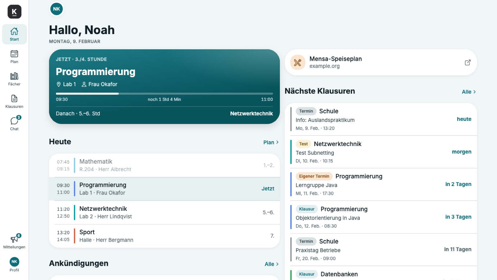

**Same code, two workspaces.** Left: the pilot workspace (red, serif titles, compact header). Right: a fictional vocational school (petrol, system font, large header). Neither screen has any school-specific code. Only the config is different.

<table>
  <tr>
    <td>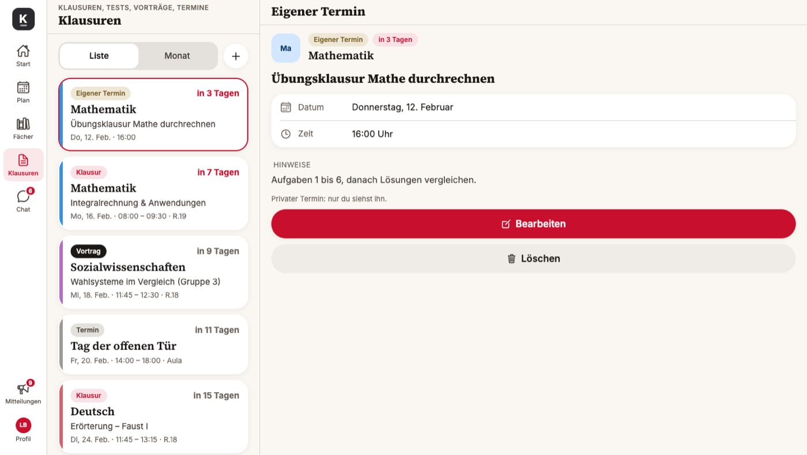</td>
    <td>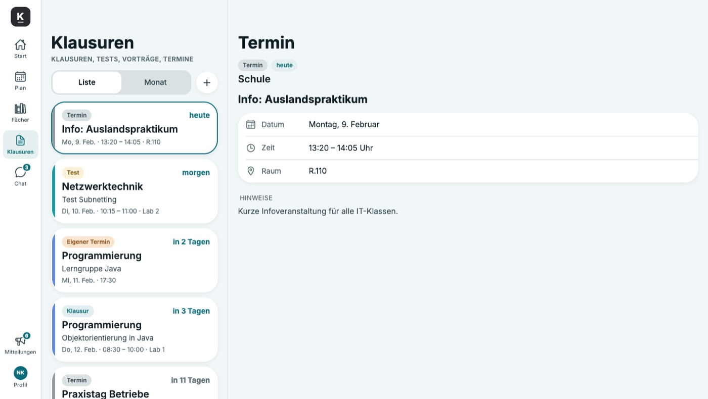</td>
  </tr>
</table>

**Adaptive layouts: iPhone, iPad, iPad mini (teacher role)**

<table>
  <tr>
    <td width="22%">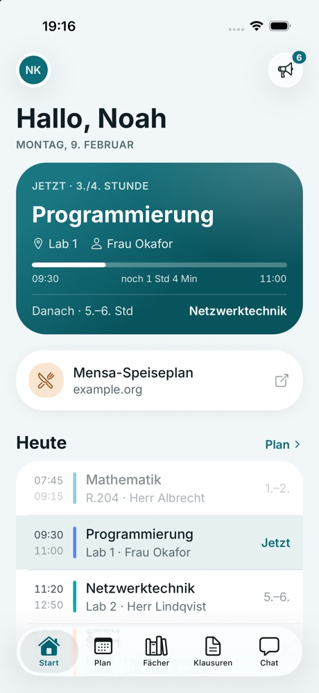</td>
    <td width="39%">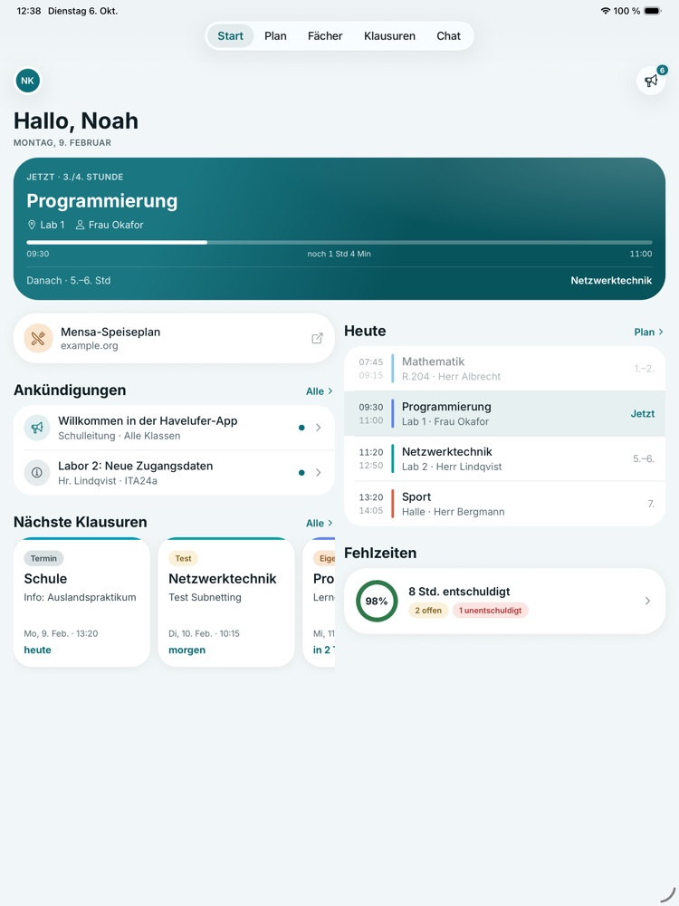</td>
    <td width="39%">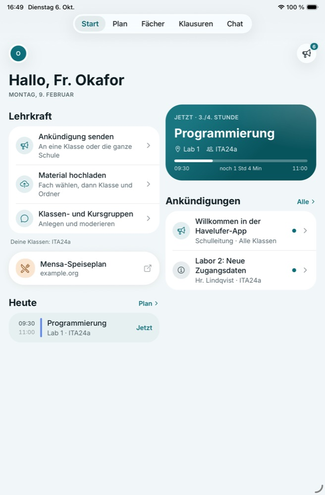</td>
  </tr>
</table>

<table>
  <tr>
    <td width="40%">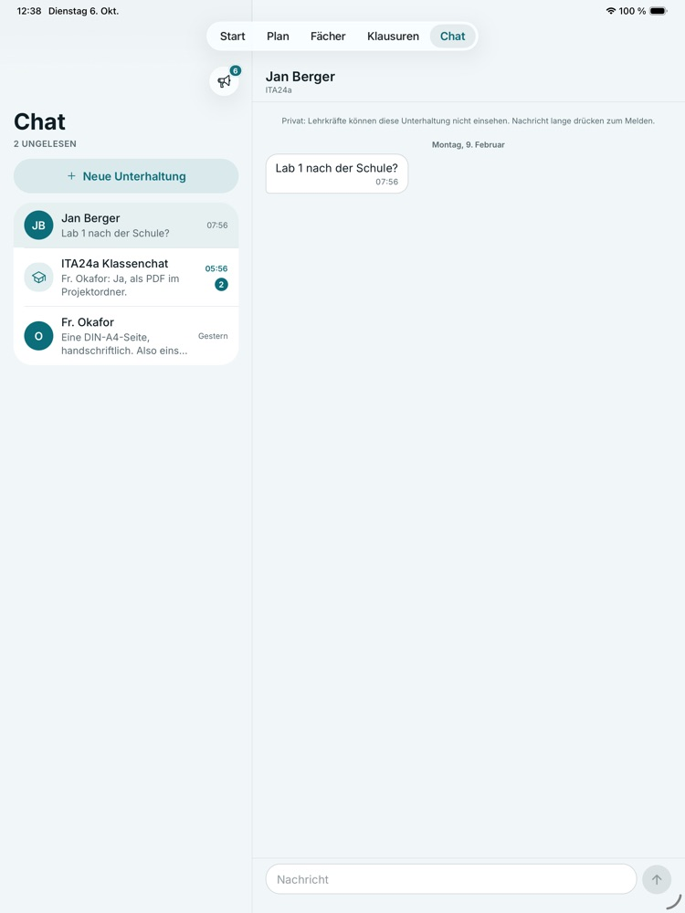</td>
    <td width="60%">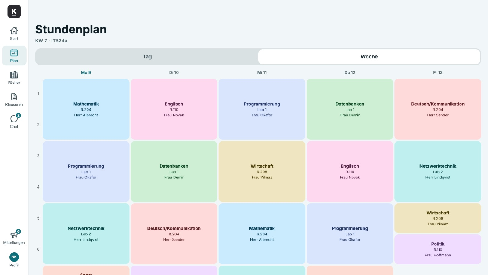</td>
  </tr>
</table>

**Admin console: internship attendance.** Doctor's notes count as health data, so only the school office can see them. Teachers are blocked, and every access is logged.

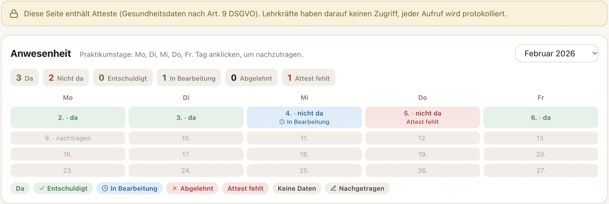

---

## What it does

Schools usually juggle a timetable tool, Teams, email and paper forms. Kreide puts the everyday parts in one app:

- **Timetable:** "now" card with live progress, day and week views
- **Subjects and materials:** teachers upload files and folders per class
- **Exams:** exams, tests, presentations and private student reminders, as a list or a month view
- **Chat:** direct and group chats. Teachers moderate class groups, students can report and block, and a word filter with built-in rules plus per-school lists checks every message before it's sent
- **Announcements**
- **Attendance:** read-only, from the school's system
- **Internship check-in:** daily check-in plus doctor's note upload. An absence only counts as excused after the school office approves the note, and every decision is audited
- **Web login by QR code**, like WhatsApp Web: no password, and the session ends after 5 days
- **Admin console** (Next.js): accounts and invites, weekly class timetable editor, exam calendar, internship report matrix with CSV export, a report queue for flagged chat messages (warn, mute, delete, close)

Roles: `student`, `internStudent`, `teacher`, `admin`. Users never pick their role. The invite decides it.

---

## How workspaces work

A school is one JSON config. The app loads it after the invite is redeemed, validates it, then builds the theme, tabs and home cards from it. The same schema package (TypeScript types + zod validation) is shared by the app, the console and the planned backend.

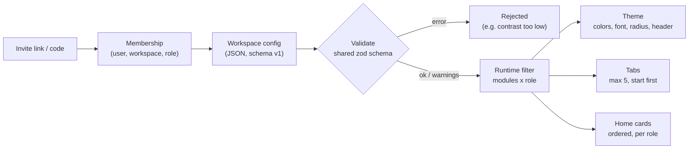

An illustrative config for a made-up school (written for this README; field names follow the real schema, and module IDs are German because the pilot is in Berlin):

```json
{
  "schemaVersion": 1,
  "id": "ws-northside",
  "slug": "northside-college",
  "name": "Northside College",
  "shortName": "Northside",
  "logo": { "monogram": "N", "background": "#1F4E79", "foreground": "#FFFFFF", "showAccentLine": false },
  "theme": {
    "primary": "#1F4E79", "accent": "#E0A526",
    "background": "#F6F8FA", "surface": "#FFFFFF",
    "textPrimary": "#111418", "textSecondary": "#3F4750", "textMuted": "#5E6873",
    "titleFont": "rounded", "headerStyle": "large", "cornerRadius": "round"
  },
  "modules": [
    { "id": "stundenplan", "enabled": true, "dataSource": "internal" },
    { "id": "klausuren", "enabled": true, "dataSource": "internal" },
    { "id": "chat", "enabled": true, "dataSource": "internal", "options": { "studentGroups": false } },
    { "id": "unterrichtsmodus", "enabled": false, "dataSource": "internal" }
  ],
  "tabs": ["start", "plan", "klausuren", "chat"],
  "homeCards": [{ "type": "jetztKarte" }, { "type": "heute" }, { "type": "naechsteKlausuren" }],
  "roles": ["student", "teacher", "admin"]
}
```

(`stundenplan` = timetable, `klausuren` = exams, `unterrichtsmodus` = focus mode, `jetztKarte` = "now" card.)

What validation catches, among other things:

- **Contrast:** primary text needs 7:1 on background and surface (WCAG formula), white on `primary` needs 4.5:1. A school can't ship an unreadable theme.
- **Structure:** at most 5 tabs, `start` required, no duplicate modules or cards, only https links.
- **Consistency:** an external data source only for attendance, chat options only on the chat module, private reminders only if exams are on.
- **Soft rules:** a tab or card for a disabled module is a warning, and the client hides it at runtime.

Roles and surfaces:

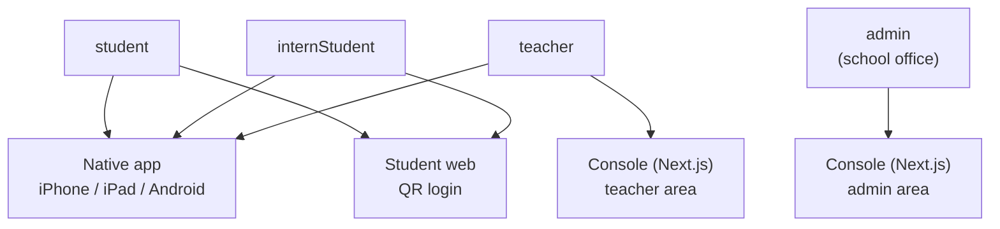

Some of the access rules: teachers moderate only their own class groups and never read private student chats. Only the school office sees doctor's notes. Internship check-in and note uploads stay in the native app.

Architecture (current state: everything runs against mock repositories, so a real backend can drop in behind the same interfaces):

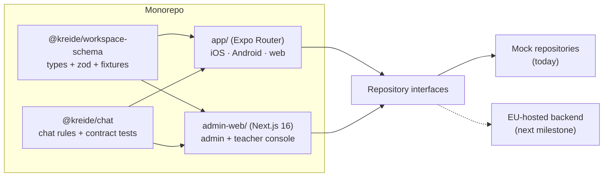

---

## Tablet and adaptive design

Tablets were a hard requirement from day one, not a scaled-up phone layout.

- **Breakpoints follow window width, not device type,** so Split View and Stage Manager work too: compact < 600 pt, regular ≥ 600 pt, wide ≥ 1000 pt. They're defined once in the design system.
- **List and detail side by side** for chat, subjects, exams and announcements. The selection lives in the URL, so a reload keeps it.
- **Home screen** becomes a 2 to 3 column layout with cards packed by estimated height. In landscape it turns into a two-column dashboard.
- **Week view** is the default timetable on wide screens. Body text is capped at 700 pt per line, and sheets open as centered form sheets.
- **Orientation:** iPhone stays portrait, iPad rotates freely, and Android phones are locked at runtime.
- **Keyboard and pointer:** hover states, Enter sends in chat (Shift+Enter adds a new line on web), and focus order follows reading order.
- **Accessibility:** Dynamic Type up to the largest accessibility size, tap targets of 44 pt or more, and a theme contrast check enforced by the schema.
- **Web** reuses the tablet layouts behind a Teams-style left rail. Below about 1000 px it falls back to the iPad layout.

---

## How it was built

I build Kreide by directing AI coding agents (Claude Code and Codex). I write the specs, split the work into milestones and stacked PRs, make the product decisions, and design the verification process. The agents write the code. I review the evidence and approve every merge.

The workflow:

1. **Spec first.** A product spec with user stories and acceptance criteria, a workspace schema spec, a privacy assessment, and a decision log. Decisions are dated, for example "only the school office reviews doctor's notes".
2. **Plan as stacked PRs.** A milestone becomes small PRs with explicit "done when" criteria. For example, the backend-readiness milestone shipped as 9 stacked PRs plus a CI fix.
3. **Agents implement** in isolated git worktrees, one task per agent.
4. **Gates:** typecheck, lint, unit and component tests, `expo-doctor`, a release config check and a web export, all in GitHub Actions CI.
5. **Independent audits:** at least two separate agent reviews per PR, plus fix rounds.
6. **Live verification on the real UI**, not only tests:
   - Chrome and Edge are driven through the DevTools protocol with real mouse and keyboard events at 1440, 1280, 900 and 550 px.
   - Safari and the iPhone/iPad simulators are driven by a computer-use agent.
   - Each run saves screenshots, logs and accessibility trees, and UI changes get a short review video.
   - These rules live in a project agent skill (`verify-kreide`): own ports, own simulators, test data only, never delete evidence.
7. **Design review** of the screens in a design tool, with fixes fed back as tasks.

By the numbers (counted from the repo on 31 Oct 2026):

| | |
|---|---|
| Started | 30 Sep 2026 (first SwiftUI prototype, moved to Expo on 5 Oct) |
| Commits | 2,591 across all branches (mostly agent work branches), 347 on `main` |
| Merged PRs | 40 |
| QA runs | 52 dated QA folders with 135 written reports and 3,100+ screenshots as evidence |
| Tests | 138 test files, about 1,100 test cases |
| Code | about 24k lines of TypeScript (excluding tests) |
| Surfaces | native app, student web, admin/teacher console |
| Demo workspaces | 2 (pilot school + a fictional vocational school) |

---

## Tech stack

- **App:** Expo SDK 57, React Native 0.86, Expo Router, react-native-web, TypeScript strict, TanStack Query, Reanimated, bundled fonts (Inter, Source Serif 4, Nunito)
- **Console:** Next.js 16 (App Router), React 19, Tailwind CSS 4
- **Shared packages:** `@kreide/workspace-schema` (zod 4), `@kreide/chat` (chat rules with a shared contract test suite for every repository implementation)
- **Testing:** Jest, Vitest, Testing Library, Node test runner, CDP-driven browser journeys, simulator runs
- **Tooling:** npm workspaces monorepo, GitHub Actions, EAS build profiles prepared
- **Backend:** none yet. Data access goes through repository interfaces with mocks. An EU-hosted backend with per-workspace row-level security is the next milestone.

---

## Status

- Pilot with my former school in Berlin, **test data only**. No real student or teacher data has ever been in the app.
- Working today, against mock data: the native app (verified on iPhone and iPad simulators), the student web app (Chrome, Edge, Safari) and the admin/teacher console.
- Not done yet:
  - real backend and auth
  - TestFlight and store release
  - Android device build
  - focus mode (the UI exists, but nothing is blocked yet)
  - final legal texts
- Next: backend (EU hosting), then TestFlight.

---

## Contact

Panagiotis (Pano) Bartzokas · [x.com/panootw](https://x.com/panootw)
